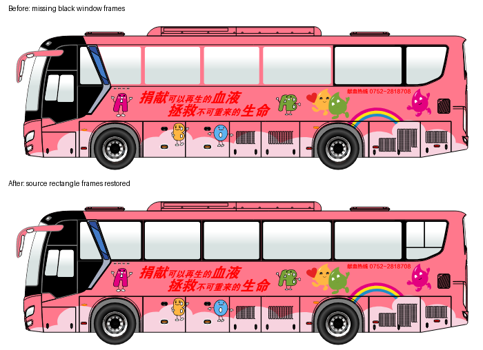

# FS 矩形车窗漏读修复

2026-10-19，在已有未提交修改的工作区验证。本次只修改 `core/fs_geometry.py`，新增 `tests/test_fs_rectangles.py` 及本说明。

3261129 的尾部玻璃与黑色窗带使用 ARectangle，旧扫描器未读取该类。增加零圆角矩形解码，保留原填充、渐变、源顺序，矩阵仅应用一次；未确认的非零圆角不按普通矩形猜测。

真实 FS 对照：场景增加 10 个可见矩形，包含两侧尾部的 3 个渐变填充矩形（一个矩形覆盖多块窗框）。全场景及导出 PNG 已人工查看；导出 SVG 的 3 个玻璃路径均保留渐变引用，28 个导出文件的摘要均与清单一致。原 FS 摘要由导出流程在前后核对，原下载成果保留，修复成果另存。

验证命令：

```powershell
python -X utf8 -m unittest tests.test_fs_rectangles test_fs_geometry test_fs_gradients test_fs_display -v
python -X utf8 -m unittest test_components test_reviewed_exports tests.test_directional_exports tests.test_source_regions tests.test_paint_layers -q
git diff --check
```

共 59 项测试通过，差异空白检查通过。未调用 AI 接口，未重新打包 EXE。完整本机对照输出位于 `.local/tasks/20261019_missing_glass/`，不提交原 FS 或完整场景 JSON。

## 2026-10-22：新凯歌单前档窗框

样本 `3240141`，SHA-256 `78ef1eeaa2723eb7acdce763e9f9f1871b42b6c3de162849c86df1c5b6985494`。初始工作区已有其他任务修改，本轮不改其业务文件；收尾时这些修改已由外部任务处理。本轮仅改矩形解码和对应测试，并保留本节、必要对照图及原生静态证据。

观察：窗框是独立黑色 `ARectangle`，例如对象 2333，尺寸约 13.414 × 6.607，参数字段 2 为 `f64=353.0211366027331` 加字节 `1`。此前把该字节当作未解释的编码，只要前面的数值非零就拒绝整个矩形，导致玻璃渐变保留但黑色窗框丢失。

官方静态证据：`Plugins/fsfigure.dll` SHA-256 `28ea445060d95469820348cf333334cd7615f94e04f77f14c46f57d8b3764eff`，REA/Ghidra 12.1.4。完整返回及局限保存于 [rectangle_corners.json](../../research/native_rendering/rectangle_corners.json)。

- `ARectangle::flexiSerialize`（与 ABorder 等共享地址 `0x10004560`）写字段 0=AFigure、字段 1=属性对象。Evidence `ev_8865f35ad51443a76aec5409648bf7c4a29818c4fc5968a08c90748ef77a1aec`。
- 属性虚表 +0x2c 指向 `0x1000a550`：字段 1 存宽高，字段 2 存 this+0x28 的 double 与 this+0x24 的样式字节，字段 3 是边框开关。Evidence `ev_d4480607e50b78d34c7462e2c8d5e5429d1f16f8dcde50be7c7ae0f1e0ec86ed`。
- `ARectangle::convertToPath` `0x10009f10`：样式 1 直接令半径为零，忽略保留数值；其他样式才按 `min(amount,100)*min(width,height)*0.005` 计算。Evidence `ev_4adab7cfac3230940b9f77c3d52fe2003334de9d5aa36121af9eedce98c23dd4`。这是静态实现证据，未执行官方软件或宣称全渲染等价。

修复仅让直角样式忽略残留圆角值；非零圆角样式与边框效果仍保持原有拒绝边界。未添加猜测的圆角或改动原稿。回归覆盖 32/64 位 TLV、残留值大于 100、镜像与剪切矩阵，以及对象扫描入口。

真实样本原始几何 5,027 → 5,058；整页组合后 2,998 → 3,025，新增 27 个可见对象，其中黑色 22 个。已检查窗框恢复、SVG/PNG 渲染、`components.load_scene`（AI 场景入口）得到同样 3,025 个对象，源文件摘要前后一致。子对象可能合并进 AComposite，因此不能要求所有叶 ID 都直接出现在场景中。



本轮实际执行上列两条 unittest 命令，分别 20 与 53 项，共 73 项通过；`git diff --check` 通过。未调用真实 AI，未重做语义分类，未重新打包 EXE。旧任务清单与分类结果不会自动变成新结果，需用更新后的程序重新提取。完整本机证据在 `.local/tasks/20261022_window_frames/`；仅删除本轮两个临时排查脚本，保留原稿、已有输出与本轮验收依据。
